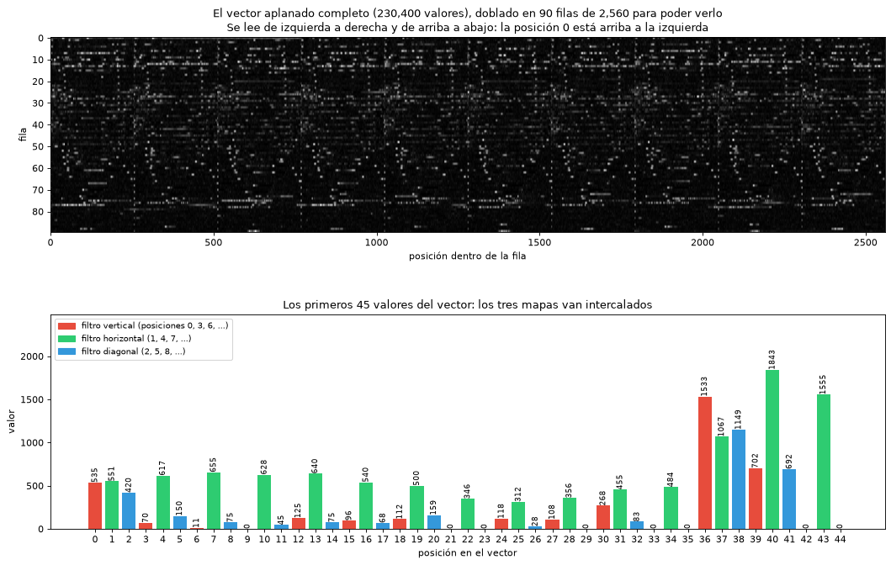
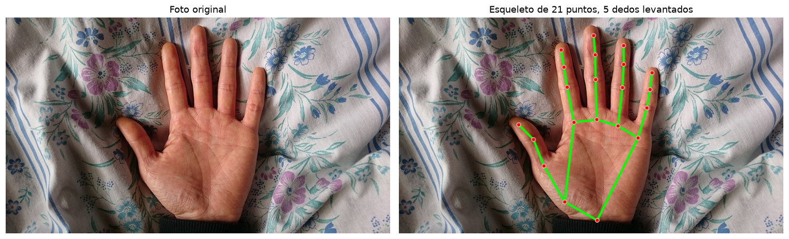

# Solucionario de Inteligencia Artificial (SI3003)

**Juan David Sierra Orozco**
Universidad EAFIT, semestre 2026-2

Repositorio con las actividades y laboratorios de clase resueltos. Cada carpeta corresponde a una clase del curso y contiene la entrega de esa sesión.

---

## Contenido

| Clase | Tema | Entrega | Estado |
|---|---|---|---|
| 1 | Agentes racionales | [`clase1-agentes-racionales/`](clase1-agentes-racionales/) | Completa |
| 3 | Optimización local | [`clase3-optimizacion/`](clase3-optimizacion/) | Completa |
| 4 | Procesos de decisión de Markov | [`clase4-mdps/`](clase4-mdps/) | Completa |
| 5 | Aprendizaje por refuerzo | [`clase5-reinforcement-learning/`](clase5-reinforcement-learning/) | Completa (2 entregas) |
| 6 | Pipeline de clasificación | [`clase6-pipeline-clasificacion/`](clase6-pipeline-clasificacion/) | Completa (3 challenges) |
| 5 | Aprendizaje por refuerzo | [`clase5-reinforcement-learning/`](clase5-reinforcement-learning/) | Completa (4 entregas: 2 ejercicios y 2 notebooks de clase resueltos) |
| 7 | Clasificación supervisada | [`clase7-clasificacion/`](clase7-clasificacion/) | Completa (5 ejercicios) |
| 7 | Clasificación supervisada | [`clase7-clasificacion/`](clase7-clasificacion/) | Completa (5 ejercicios + 3 notebooks de Keras) |
| 8 | Regresión | [`clase8-regresion/`](clase8-regresion/) | Completa |
| 8 | Redes convolucionales | [`clase8-convolucion-cnn/`](clase8-convolucion-cnn/) | En progreso (6 ejercicios y el taller de transfer learning) |
| 8 | Redes convolucionales | [`clase8-convolucion-cnn/`](clase8-convolucion-cnn/) | En progreso (6 ejercicios) |
| 9 | Chatbots con LLMs (NVIDIA NIM) | [`clase9-chatbots/`](clase9-chatbots/) | Resuelta; llamadas al modelo pendientes de API key |

---

### Clase 1 — Agentes racionales

[`clase1-agentes-racionales/clase1.md`](clase1-agentes-racionales/clase1.md)

Ficha de análisis de un Space de Hugging Face desde la perspectiva de los agentes racionales. Incluye el análisis PEAS, la clasificación del entorno con su justificación, el tipo de programa de agente propuesto, y el reto adicional con dos Spaces más: uno totalmente observable, determinista y episódico, y otro parcialmente observable, estocástico y secuencial.

Space analizado: [Z-Image-Turbo](https://huggingface.co/spaces/mrfakename/Z-Image-Turbo), generación de imágenes a partir de texto.

---

### Clase 3 — Optimización local

[`clase3-optimizacion/02_simulated_annealing_resuelto.ipynb`](clase3-optimizacion/02_simulated_annealing_resuelto.ipynb)

Notebook de Simulated Annealing con las tres actividades resueltas, cada una con su análisis escrito:

- **Actividad 1, temperatura inicial.** Barrido de `T0` en `{0.01, 0.1, 0.5, 1, 3, 10}` con 30 corridas por valor, reportando media, desviación estándar y porcentaje de corridas que alcanzan el óptimo global.
- **Actividad 2, calendario de enfriamiento.** Comparación de `alpha` en `{0.85, 0.90, 0.95, 0.99, 0.992, 0.999, 1.0}`, con la verificación directa de por qué enfriar demasiado rápido degenera en Hill Climbing.
- **Actividad 3, problema discreto.** Adaptación de Simulated Annealing al problema de ubicación de hospitales del notebook anterior, usando la regla de aceptación para minimización, y comparación estadística contra Hill Climbing sobre 30 corridas.

[`clase3-optimizacion/actividad-asistencia.pdf`](clase3-optimizacion/actividad-asistencia.pdf)

Actividad de asistencia de la sesión, resuelta a mano: relación entre el método simplex y hill climbing, planteamiento del problema como flujo en red, definición de la función objetivo, y por qué los métodos de búsqueda local no garantizan el óptimo global.

---

### Clase 4 — Procesos de decisión de Markov

[`clase4-mdps/03_lab_warehouse_resuelto.ipynb`](clase4-mdps/03_lab_warehouse_resuelto.ipynb)

Laboratorio del robot de entregas en un almacén, resuelto de punta a punta.

**Parte 1.** Modelado del MDP a partir de la imagen del enunciado: grid de 5x6 con 26 estados transitables, cuatro estanterías, tres celdas de piso resbaloso, tres terminales y dos peligros no terminales. La transición `T(s,a,s')` reparte la probabilidad según el piso del estado actual, `0.90/0.05/0.05` en piso normal y `0.60/0.20/0.20` en piso resbaloso.

**Partes 2 y 3.** Value Iteration y Policy Iteration implementadas por separado. Ambas convergen a la misma política óptima: Value Iteration en 20 iteraciones, Policy Iteration en 4 iteraciones de política que suman 210 barridos de evaluación.

**Parte 5.** Las cinco preguntas de interpretación respondidas, más los tres experimentos y el bonus. Resultados principales:

- Con los parámetros base el robot prefiere la estación de carga `+2` antes que la zona de entrega `+10`, porque el costo por paso se come la diferencia.
- El estado `(1,2)` es la bisagra de todo el problema. Con `gamma = 0.99` cambia únicamente ese estado, y eso basta para redirigir la ruta completa hacia la entrega.
- El experimento del piso más resbaloso no cambia la política en ningún estado, solo empeora los valores, porque `(1,2)` es un cuello de botella sin ruta alternativa.
- El punto de quiebre del costo por paso está en `living_reward` cercano a `-0.80`, y el cambio de comportamiento es abrupto, no gradual.

---

### Clase 5 — Aprendizaje por refuerzo

[`clase5-reinforcement-learning/ejercicio_grid15_vi_pi_qlearning.ipynb`](clase5-reinforcement-learning/ejercicio_grid15_vi_pi_qlearning.ipynb)

Ejercicio de clase: construir un grid de 15x15 con 5 obstáculos, un inicio y un final, y trazar el mejor camino entre ambos usando método de valores, política de dirección y aprendizaje por refuerzo, mostrando el avance a lo largo de las iteraciones.

El mismo mundo se resuelve de tres maneras para poder compararlas. Las transiciones son estocásticas (`0.8 / 0.1 / 0.1`, la convención usada en clase), de modo que los obstáculos representan un riesgo real y el problema no se reduce a un camino más corto.

**Método de valores (Value Iteration).** Converge en 58 iteraciones. Se incluyen imágenes del grid en las iteraciones 1, 2, 5, 15 y 30, donde se observa cómo el valor nace en la meta y se propaga hacia atrás una celda por barrido, más la curva de convergencia en escala logarítmica.

**Política de dirección (Policy Iteration).** Converge en 18 iteraciones de política que suman 2766 barridos de evaluación, y llega exactamente a la misma política que Value Iteration, con cero estados en desacuerdo.

**Aprendizaje por refuerzo (Q-Learning).** 5000 episodios con epsilon decreciente, partiendo de una tabla en cero y sin acceso a `T(s,a,s')`. El avance del entrenamiento se documenta con una tabla de progreso por checkpoint y con cuatro mapas de la política aprendida en distintos momentos.

Resultados sobre 300 episodios de evaluación:

| Método | Recompensa | Pasos | Llega a la meta |
|---|---|---|---|
| Value Iteration | 67.49 | 33.5 | 100% |
| Policy Iteration | 67.49 | 33.5 | 100% |
| Q-Learning | 67.11 | 33.9 | 100% |

Como en este mundo se conoce la solución óptima, es posible medir cuánto le falta al agente durante el entrenamiento: la pérdida media de valor cae de `52.5` en el primer episodio a `1.03` al final.

El análisis de cierre discute por qué solo el 74.9% de las acciones aprendidas coinciden con las óptimas y aun así el desempeño es prácticamente idéntico. La causa no son empates entre caminos equivalentes, que representan apenas el 1.4% de los estados, sino que los errores se concentran en zonas alejadas del corredor que el agente recorre. Q-Learning aprende bien únicamente lo que visita.

[`clase5-reinforcement-learning/02_frozenlake_qlearning_resuelto.ipynb`](clase5-reinforcement-learning/02_frozenlake_qlearning_resuelto.ipynb)

Trabajo en clase de Q-Learning con FrozenLake, con las 6 actividades, la comparación "qué cambió" y las 4 preguntas de cierre respondidas, y celdas de código que respaldan cada respuesta con números reales (semillas fijas y `aislado()` para que las verificaciones no consuman el generador global).

- La Q-table de 16x4 = 64 valores pasa de 0 celdas distintas de cero a 35 tras 10 000 episodios; el estado 14 muestra la lectura de una fila (`Right = 1.0`, `Down = 0.95`, `Left` y `Up = 0.9025`).
- En el ambiente determinístico la política greedy gana el 100% de los episodios. Explorar con `epsilon = 0.3` en evaluación la baja a 0.68.
- En el ambiente resbaloso la media de evaluación es 0.702, pero entre 5 semillas varía de 0.158 a 0.748: el resultado es mucho menos estable.

[`clase5-reinforcement-learning/03_taxi_qlearning_resuelto.ipynb`](clase5-reinforcement-learning/03_taxi_qlearning_resuelto.ipynb)

Trabajo en casa de Q-Learning en Taxi-v4 (500 estados, 6 acciones, 3000 valores por aprender). Implementa `choose_action`, `update_q` y `train_q_learning`, la curva de aprendizaje, la comparación antes y después del entrenamiento, y responde las 7 preguntas.

- La recompensa media sube de -308.9 en los primeros 100 episodios a +2.4 hacia el final, y se estabiliza cerca del episodio 1400. La política greedy resuelve el 100% de 200 episodios de evaluación (recompensa media cercana a 8).
- Experimento de la pregunta 7 (solo `alpha`, 0.1 contra 0.5): con 0.5 se estabiliza hacia el episodio 531 en vez del 1473, con el mismo resultado final.

[`clase5-reinforcement-learning/verificacion_rostros_rl.ipynb`](clase5-reinforcement-learning/verificacion_rostros_rl.ipynb)

Segundo ejercicio: verificación de identidad facial donde la decisión la toma una política aprendida con Q-Learning.

El problema se separa en dos capas y solo la segunda usa refuerzo. La percepción se resuelve con PCA (eigenfaces) y distancia coseno contra una galería de 5 fotos por identidad, lo cual reduce cada caso a un número. Sobre esa señal, el agente aprende a elegir entre `aceptar`, `rechazar` y `pedir otra foto`, con un falso positivo penalizado cuatro veces más que un falso negativo.

El aporte del refuerzo es aprender **cuándo todavía no conviene decidir**. Sin que nadie se lo indique, el agente descubre la franja de distancias donde las distribuciones de "misma persona" y "persona distinta" se solapan, y en esa zona pide evidencia adicional en lugar de arriesgarse.

Resultados sobre identidades que el agente nunca vio durante el entrenamiento:

| Método | Recompensa | Fotos usadas | Exactitud | Falsos positivos |
|---|---|---|---|---|
| Umbral fijo óptimo, 1 foto | 0.655 | 1.00 | 89.6% | 273 |
| Política aprendida con RL | 0.679 | 1.77 | 91.2% | 215 |

La reducción de falsos positivos es del 21%. Un experimento adicional barre el costo de pedir evidencia y muestra que la ventaja desaparece cuando ese costo supera aproximadamente `0.05`: a partir de ahí el agente deja de pedir fotos y su política colapsa a la del umbral fijo.

---

### Clase 6 — Pipeline de clasificación

[`clase6-pipeline-clasificacion/`](clase6-pipeline-clasificacion/)

Los tres challenges del pipeline de clasificación aplicados al dataset Wine (178 muestras, 13 variables, 3 clases), ejecutados de punta a punta y encadenados por artefactos (`train.csv`, `test.csv`, `data_contract.json`, `champion_model.joblib`):

- **Challenge 1, datos y EDA** (`semana6_challenge1_datos.ipynb`). Profiling (sin nulos ni duplicados), split estratificado 80/20, EDA solo sobre train con tres hallazgos y contrato de datos.
- **Challenge 2, entrenamiento** (`semana6_challenge2_entrenamiento.ipynb`). Pipelines con preprocesamiento interno para árbol, regresión logística y KNN, validación cruzada de 5 folds y `GridSearchCV`. Campeón: regresión logística con accuracy de CV de 0.979.
- **Challenge 3, evaluación e inferencia** (`semana6_challenge3_evaluacion_despliegue.ipynb`). Test abierto una sola vez: accuracy 0.972 y F1 macro 0.971, función `predict` con validación de esquema y predicciones por lotes.

---

### Clase 7 — Clasificación supervisada

[`clase7-clasificacion/clasificadores_iris.ipynb`](clase7-clasificacion/clasificadores_iris.ipynb)

Comparación de tres clasificadores sobre el dataset Iris (incluido en scikit-learn) — **LDA**, **K-NN (k=3)** y **Árbol de decisión** — repetida sobre tres particiones estratificadas distintas: **70/30**, **60/40** y **80/20**.

Cada modelo se entrena primero con las 4 características (largo y ancho de sépalo y pétalo), que es el resultado real reportado como desempeño, y luego solo con largo y ancho de pétalo, las dos variables que mejor separan las especies, para poder dibujar las fronteras de decisión. Esto se repite para las tres particiones, con una cuadrícula de 9 paneles (partición × modelo) para comparar las fronteras de un vistazo.

Resultados con las 4 características, en cada partición:

| Modelo | 70/30 | 60/40 | 80/20 |
|---|---|---|---|
| LDA | 97.8% (44/45) | 98.3% (59/60) | 100% (30/30) |
| K-NN (k=3) | 95.6% (43/45) | 96.7% (58/60) | 100% (30/30) |
| Árbol de decisión | 93.3% (42/45) | 95.0% (57/60) | 93.3% (28/30) |

Ningún modelo confunde jamás la especie *setosa*, que es linealmente separable de las otras dos. Todos los errores, en los tres clasificadores y en las tres particiones, ocurren distinguiendo *versicolor* de *virginica*, que es donde las mediciones de las dos especies genuinamente se solapan.

La jerarquía LDA ≥ K-NN ≥ Árbol se mantiene en las tres particiones y se confirma con una validación cruzada de 5 pliegues sobre los 150 datos completos (LDA 98.0%, K-NN 96.7%, Árbol 95.3%), lo que descarta que sea un efecto de haber elegido justo la partición 70/30. El 100% de LDA y K-NN con 80/20 no significa un clasificador perfecto: el conjunto de prueba se reduce a 30 muestras y, en esa partición particular, no incluyó ninguno de los casos límite entre las dos especies que sí aparecen con otras proporciones — una ilustración directa de por qué una sola partición puede ser optimista o pesimista según el azar del muestreo.

Las fronteras de decisión muestran el sesgo de cada algoritmo: LDA traza una única recta inclinada, K-NN una curva irregular ajustada al detalle local, y el árbol una sucesión de rectángulos por sus cortes perpendiculares a los ejes. Los casos mal clasificados de cada modelo aparecen siempre pegados a esa frontera, nunca dentro de una región limpia, lo que confirma que el error no es azar sino la zona genuinamente ambigua del problema.

[`clase7-clasificacion/ejercicio2_neurona_escalon.ipynb`](clase7-clasificacion/ejercicio2_neurona_escalon.ipynb) — **segunda iteración**

Ejercicio 2: entrenar de forma iterativa una neurona artificial de 5 entradas, buscando los pesos que acerquen $\hat{y}$ al objetivo $y$. Se desarrolla en dos partes que se construyen una sobre la otra.

**Parte 1 — activación escalón (on/off), $\hat{y}=f(\sum_i w_i x_i)$.** El enunciado mismo anticipa el resultado: se espera que falle, y falla de dos maneras verificadas por separado. Usando la derivada real de la función escalón (cero en casi todo punto), el descenso de gradiente no mueve un solo peso en 200 iteraciones: el MSE del primer epoch y del último son idénticos. Aplicando en cambio la regla delta ignorando que la activación no es diferenciable, los pesos sí cambian, pero divergen sin límite (la norma crece de 5.2 a 521.3 entre los epochs 50 y 4999) mientras el error queda congelado en 20.02, apenas 16% mejor que el piso de responder siempre la misma constante sin mirar los datos (23.73). Un control con activación lineal sobre los mismos datos recupera los 5 pesos reales con error menor a 0.06 en cada uno, lo que confirma que la falla es de la activación escalón, no de los datos ni del método.

**Parte 2 — cambiar a activación sigmoide, con función de costo MSE explícita y offset.** Repetir la Parte 1 cambiando solo la activación no basta: sobre el mismo objetivo sin acotar, la sigmoide apenas mejora (MSE 19.98 contra 20.02 del escalón), porque el 84% de sus predicciones terminan saturadas en 0 o 1, reconstruyendo por su cuenta algo parecido a un escalón. La falla real de la Parte 1 no era solo la falta de derivada: era que el rango de salida de la activación no coincide con el rango del objetivo. Repitiendo la estimación con un objetivo generado a través de una sigmoide real —la misma recta $w_{\text{real}}\cdot x+b_{\text{real}}$ observada como en regresión logística—, el MSE cae a $5.99\times10^{-4}$ y los pesos hallados quedan a una distancia de apenas $0.052$ de los reales en norma:

| | $w_1$ | $w_2$ | $w_3$ | $w_4$ | $w_5$ | offset |
|---|---|---|---|---|---|---|
| Real | 1.500 | −2.000 | 0.800 | 3.000 | −1.200 | 0.500 |
| Hallado | 1.485 | −1.971 | 0.796 | 2.966 | −1.179 | 0.501 |

Moraleja de los dos ejercicios juntos: hacen falta dos condiciones a la vez para que una neurona entrenada por gradiente funcione, una activación diferenciable en todo su dominio y que esa activación pueda producir efectivamente los valores del objetivo. El escalón falla por lo primero; la sigmoide sobre un objetivo sin acotar falla por lo segundo, a pesar de cumplir lo primero.

[`clase7-clasificacion/ejercicio3_subajuste_sobreajuste.ipynb`](clase7-clasificacion/ejercicio3_subajuste_sobreajuste.ipynb)

Ejercicio 3: provocar subajuste y sobreajuste sobre Iris por dos vías —particiones inusuales (50/50, 60/40) y complejidad de modelo sin justificar (`k=7` en K-NN)— diagnosticando con la brecha entre exactitud de entrenamiento y de prueba.

**La partición (Opción 1) no demostró la hipótesis ingenua.** Promediando 30 semillas por partición, el sobreajuste del árbol (siempre con 100% de exactitud en entrenamiento) se mantiene prácticamente constante entre 50/50 y 90/10, entre 0.047 y 0.057 de brecha, sin empeorar de forma clara con menos datos. Lo que sí cambia con la partición es el **ruido de la medición**: con 90/10 la desviación estándar del test accuracy casi se triplica respecto a 50/50, porque el conjunto de prueba queda en solo 15 muestras. La lección real: una partición inusual no arruina al modelo, arruina la **confiabilidad del diagnóstico** si no se repite.

**La complejidad (Opción 2) sí mostró sub y sobreajuste genuinos, con una sorpresa.** `k=1` en K-NN sobreajusta de manual (train 100%, test 93.3%). Pero `k=7`, el valor que sugiere el enunciado como aumento injustificado, en realidad **mejora** la cross-validation (0.980 contra 0.967 de k=3), porque Iris es un dataset limpio y bien separado. El subajuste real solo aparece desde `k≈31`, y `k=105` (el tamaño exacto del set de entrenamiento) colapsa la exactitud a 0.333, el nivel de azar con 3 clases: el modelo pasa a votar siempre por la clase mayoritaria sin mirar dónde cae el punto, visible en la frontera de decisión como un plano de un solo color. El árbol de decisión repite la historia desde el otro extremo: `max_depth=1` subajusta (66.7% de exactitud, solo separa *setosa*), `max_depth=3` es el óptimo de cross-validation (0.973), y pasado ese punto el árbol "sin límite" no gana capacidad real —el número de hojas se estanca en 8 desde `depth=5`— pero sí sobreajusta visiblemente: una pequeña isla en la frontera de decisión existe únicamente para clasificar bien un solo punto de entrenamiento.

[`clase7-clasificacion/ejercicio4_ann_wine.ipynb`](clase7-clasificacion/ejercicio4_ann_wine.ipynb)

Ejercicio 4: entrenar una ANN completa (no solo una neurona) para clasificar el Wine Dataset (178 vinos, 13 variables físico-químicas, 3 cultivares), con validación cruzada y partición 70/30. Arquitectura de una capa oculta, 13 entradas totalmente conectadas, activación sigmoide en ambas capas, 3 neuronas de salida (una por clase, codificación one-hot) y función de costo MSE, con backpropagation implementado desde cero.

[`clase7-clasificacion/ejercicio5_mlp_wine.ipynb`](clase7-clasificacion/ejercicio5_mlp_wine.ipynb)

Ejercicio 5: el mismo problema del Wine Dataset con `MLPClassifier` de scikit-learn, con validación cruzada y partición 70/30, y matriz de confusión para comparar con la ANN construida desde cero del ejercicio anterior.

Es la continuación directa de los Ejercicios 2 y 3: backpropagation es la misma regla de la neurona única, aplicada dos veces en cadena, y hereda exactamente las mismas debilidades. **Se verifica antes de entrenar el modelo final**: `proline` va de 278 a 1680 mientras otras variables no pasan de 1, así que sin normalizar, el 100% de las neuronas ocultas satura y la exactitud cae a 38.9%, casi azar entre 3 clases. Estandarizando cada variable con la media y desviación del conjunto de entrenamiento (nunca con el de prueba, para no filtrar información), la exactitud sube a 98.1%, confirmada por una validación cruzada de 5 pliegues (98.3% ± 1.4%).

Métricas de desempeño por clase, no solo exactitud global:

| Clase | Precisión | Recall | F1 |
|---|---|---|---|
| class_0 | 0.947 | 1.000 | 0.973 |
| class_1 | 1.000 | 0.952 | 0.976 |
| class_2 | 1.000 | 1.000 | 1.000 |

El único error del conjunto de prueba (53 de 54 correctas) es la misma muestra vista desde dos ángulos: le resta recall a `class_0` y precisión a `class_1`. La frontera de decisión, dibujada sobre las 2 variables más separables (`od280/od315_of_diluted_wines` y `proline`, encontradas por búsqueda entre los 78 pares posibles), muestra regiones curvas en vez de las rectas de un clasificador lineal o los rectángulos de un árbol, la firma visual de una capa oculta no lineal.


[`clase7-clasificacion/semana7_challenge_cifar10_grises.ipynb`](clase7-clasificacion/semana7_challenge_cifar10_grises.ipynb)

Challenge de Keras 3 del curso: red `Flatten → Dense(128, ReLU) → Dense(10)` sobre CIFAR-10 convertido a escala de grises (7 espacios `TODO` y 14 preguntas resueltas), ejecutada con TensorFlow en CPU, 10 épocas y batch de 64 como pide el enunciado. Resultado real: **36.30% de accuracy en prueba** (pérdida 1.7775), contra 87.89% de la misma idea en Fashion-MNIST. Las clases más fáciles son `ship` (57.6%) y `airplane` (43.3%); la más difícil, `cat` (19.2%). Brecha train/validación de solo 2 puntos: subajuste, no sobreajuste.

[`clase7-clasificacion/semana7_challenge_olivetti.ipynb`](clase7-clasificacion/semana7_challenge_olivetti.ipynb)

Challenge de Keras 3 con Olivetti Faces (400 rostros, 40 personas, partición estratificada 80/20): 6 espacios `TODO` y 15 preguntas resueltas. **Con la configuración exacta del enunciado la red no aprende**: accuracy de prueba 2.50% (2 de 80, azar) y pérdida congelada en 3.689 = ln 40. El notebook lo diagnostica en vez de ocultarlo: las 64 neuronas ocultas quedan muertas (salida 0 para todas las imágenes) porque las 4096 entradas son todas positivas. Con la misma arquitectura y la entrada centrada por píxel (media y desviación de entrenamiento), el accuracy de prueba es 95.0% a 97.5% según la semilla (4 semillas), con 100% en entrenamiento, es decir, sobreajuste real con solo 320 imágenes.

[`clase7-clasificacion/semana7_fashion_mnist_red_profunda.ipynb`](clase7-clasificacion/semana7_fashion_mnist_red_profunda.ipynb)

Notebook de clase sobre Fashion-MNIST (sin `TODO`; se resuelven los experimentos sugeridos al final). Regresión logística 84.42% contra red FC 784-128-10 87.89% en prueba. Las clases más difíciles son `Shirt` (63.1%) y `Coat` (76.0%), confundidas con `T-shirt/top` y `Pullover`. Diez variantes (segunda capa oculta, `tanh`, `sigmoid`, `Dropout`, `batch_size`, `lr`, 30 épocas) quedan entre 84.9% y 88.1%: ninguna supera de forma clara a la red base, y 30 épocas muestran sobreajuste (train 95.2%, test 87.6%).

---

### Clase 8 — Regresión

[`clase8-regresion/regresion_california_housing.ipynb`](clase8-regresion/regresion_california_housing.ipynb)

Comparación de regresión **lineal**, **polinomial** (grados 2 y 3) y **logarítmica**, con métricas, líneas de estimación y validación cruzada de 5 pliegues.

**Nota sobre el dataset.** El enunciado pedía Boston Housing y California Housing. Boston Housing fue eliminado de scikit-learn desde la versión 1.2 por un problema ético documentado: incluye una variable que codifica composición racial bajo un supuesto discriminatorio. Este notebook usa solo California Housing (20640 viviendas, 8 variables), el reemplazo estándar en cualquier curso actual.

Como una línea de estimación necesita un eje X, los cuatro modelos se ajustan primero sobre `MedInc` (ingreso medio de la zona), la variable más correlacionada con el precio:

| Modelo | R² | MAE | RMSE | R² (5-fold CV) |
|---|---|---|---|---|
| Lineal | 0.473 | 0.623 | 0.832 | 0.421 |
| Polinomial (grado 2) | 0.478 | 0.622 | 0.828 | 0.425 |
| Polinomial (grado 3) | 0.483 | 0.616 | 0.824 | 0.433 |
| Logarítmica | 0.451 | 0.646 | 0.849 | 0.392 |

La curva logarítmica y las polinomiales capturan que el precio sube rápido con el ingreso bajo y se aplana después, algo que una recta no puede reproducir por no poder doblarse.

**El hallazgo no pedido por el enunciado**: al repetir el experimento con las 8 variables completas, el polinomio de grado 2 rinde bien en una sola partición (R² 0.65) pero su validación cruzada explota a un R² medio de -25, con una desviación de 51. La causa es un outlier extremo en `AveOccup` (máximo de 1243 frente a un percentil 99 de apenas 5.4): al elevarlo al cuadrado, el modelo polinomial genera coeficientes disparatados en el pliegue donde ese dato cae. Escalar las variables no lo arregla, porque el escalado no le quita peso al outlier. Filtrando menos del 3% de las filas más extremas, la validación cruzada del polinomial se estabiliza (R² medio 0.658) y de paso mejora también al modelo lineal (0.610). La lección: entre más flexible es un modelo, más sensible es a la calidad de los datos que se le entregan.

[`clase8-regresion/recta_ruido_regresion.ipynb`](clase8-regresion/recta_ruido_regresion.ipynb)

Ejercicio corto: generar 100 muestras aleatorias $(x,y)$ sobre una recta $y=mx+b$ con ruido gaussiano y pintarlas, usando $m=2.5$, $b=5.0$ y desviación del ruido $\sigma=2$.

Se agrega un paso extra no pedido por el enunciado: ajustar una regresión lineal por mínimos cuadrados sobre los propios puntos generados y comparar contra los parámetros reales. El ajuste recupera $\hat{m}=2.408$ y $\hat{b}=5.430$ frente a los valores reales $m=2.5$ y $b=5.0$, con un error absoluto menor a 0.5 en ambos casos. Sirve para mostrar la idea central de la regresión lineal: aunque cada punto individual está desplazado por el ruido, minimizar el error cuadrático sobre las 100 muestras a la vez cancela ese ruido en promedio y recupera la recta real.

---

### Clase 8: Redes convolucionales

[`clase8-convolucion-cnn/convolucion_imagenes.ipynb`](clase8-convolucion-cnn/convolucion_imagenes.ipynb)

Script que carga una imagen en RGB o en escala de grises, le aplica una convolución con un kernel de 3x3 **ingresado por el usuario** y muestra un subplot con la imagen original y la filtrada. El kernel se escribe fila por fila (acepta enteros, decimales y fracciones como `1/9`) o se elige de una lista de ocho predefinidos, y las filas inválidas se rechazan y se vuelven a pedir.

La convolución está implementada a mano con NumPy, en una versión con ciclos anidados que es la fórmula literal de la clase y en una vectorizada, y se verificó contra SciPy en gris y en RGB. También reproduce el ejemplo numérico de la diapositiva (`C(0,0) = -74`). La salida guardada corresponde a un kernel de Sobel vertical.

Dos observaciones que salieron del ejercicio. Lo que los frameworks llaman convolución es correlación cruzada, porque no invierten el kernel; para un kernel asimétrico como Sobel, invertirlo da exactamente el negativo del resultado. Y el kernel "sharpen" de la diapositiva, con un 8 al centro, suma 0 y por eso detecta bordes en vez de afilar; para afilar de verdad el kernel debe sumar 1, y se comprueba que identidad más bordes da el kernel de nitidez con un 9 al centro.

[`clase8-convolucion-cnn/ejercicio2_dos_convoluciones.ipynb`](clase8-convolucion-cnn/ejercicio2_dos_convoluciones.ipynb)

Ejercicio 2: aplicar dos convoluciones seguidas a una imagen, con dos kernels 3x3 distintos, de modo que el segundo filtro actúa sobre la salida del primero. Se usó un desenfoque gaussiano seguido de un kernel de relieve (emboss), elegido porque su efecto se nota con claridad sobre la imagen ya suavizada, a diferencia de un detector de bordes, que deja una imagen gris de poco contraste.

Se comprobó con código que dos filtros 3x3 seguidos equivalen exactamente a uno solo de 5x5, la convolución de los dos kernels entre sí, y que el orden no importa. También que un ReLU entre los dos filtros rompe esa equivalencia, pero solo si el primer filtro produce valores negativos: con el gaussiano primero no cambia nada, y con el relieve primero descarta alrededor del 14% de los píxeles. Una comparación con ruido mostró que encadenar no siempre gana: con ruido leve el gaussiano previo empeora un poco el resultado (correlación de 0.957 contra 0.959), y con ruido fuerte lo mejora claramente (0.814 contra 0.643 con desviación 40).

[`clase8-convolucion-cnn/ejercicio3_mapas_caracteristicas.ipynb`](clase8-convolucion-cnn/ejercicio3_mapas_caracteristicas.ipynb)

Ejercicio 3: tomar una imagen RGB, aplicarle convolución con 3 kernels distintos de 3x3, ReLU a cada salida, y max pooling 2x2, y mostrar los mapas de características resultantes. Es el bloque `Conv → ReLU → Pool` de una CNN con tres filtros, y da un volumen de 3 mapas de 300x256.

Se eligieron kernels sensibles a tres orientaciones (vertical, horizontal y diagonal) y se comprobó en las figuras que cada mapa reacciona a lo esperado: el vertical a las franjas de la bandera, el horizontal a los travesaños de las estrellas y a las cintas del uniforme, y el diagonal al hombro. La convolución multicanal sigue la definición de la clase (suma sobre los canales) y coincide con SciPy, y el max pooling coincide con una versión con ciclos y con la fórmula de tamaño de salida.

Resultados medidos: ReLU deja en cero el 51% de los valores de cada mapa, y el max pooling reduce cuatro veces la cantidad de valores (de 307200 a 76800 por mapa) sin perder el máximo de ninguno. Se incluye además una variante con las tres convoluciones en cascada, porque el enunciado admite las dos lecturas; en ella cada etapa deja el mapa más disperso (51%, 54% y 56% de ceros).

Al final se aplana el volumen (Flatten) en un vector de 230400 valores, con canales al final, de modo que los tres mapas quedan intercalados. Se verificó que el volumen se reconstruye exactamente a partir del vector.



[`clase8-convolucion-cnn/ejercicio4_segmentacion_yolov8.ipynb`](clase8-convolucion-cnn/ejercicio4_segmentacion_yolov8.ipynb)

Ejercicio 4: segmentar los objetos de una imagen con YOLOv8. Se usó `yolov8n-seg` (segmentación de instancias) y no VGG, porque VGG es un clasificador que no entrega máscaras ni ubicación de los objetos. El usuario elige una imagen de prueba o carga la suya, junto con la confianza mínima, y el script devuelve y guarda la imagen segmentada, con una máscara de color por cada objeto; los datos de entrada se validan y se vuelve a preguntar si son inválidos.

Se probó con mascotas (perro y gato), personas (incluida una foto con dos personas, cada una con su propia máscara) y accesorios de vestir. Mascotas y personas se segmentan bien, en decenas de milisegundos por imagen. Los elementos de vestir se cubren solo en parte: COCO trae corbata, mochila, cartera, paraguas y maleta, pero ninguna prenda (se comprobó que ninguna de diez clases de ropa existe en el modelo), así que la chaqueta o la camisa quedan dentro de la máscara de la persona. Segmentar prendas requeriría reentrenar con un conjunto de datos de moda, como en el notebook de entrenamiento con datos propios de la clase.

El umbral de confianza resultó ser una decisión y no un detalle: en la foto de las dos personas, con 0.25 se detecta una sola corbata, y con 0.10 aparece la segunda pero también un duplicado de la primera (superposición de 0.85 entre las dos máscaras).

[`clase8-convolucion-cnn/ejercicio6_tracker_mano.ipynb`](clase8-convolucion-cnn/ejercicio6_tracker_mano.ipynb)

Ejercicio 6: tracker de esqueleto de la mano con la cámara integrada. Se usó MediaPipe Hands (`HandLandmarker`), que encadena dos CNN: un detector de palma (BlazePalm) y un regresor que devuelve 21 puntos clave del recorte de la mano. El notebook explica la arquitectura, los 21 puntos y las conexiones del esqueleto, y define `procesar_frame` (esqueleto, puntos en píxeles, lateralidad y contador de dedos levantados) y `rastrear_en_vivo` (ventana con `cv2.VideoCapture(0)`, FPS y salida con la tecla `q`), con aviso del permiso de cámara en macOS y mensaje claro si la cámara no abre.

La cámara real **no se pudo probar** al ejecutar el notebook sin pantalla. Las salidas guardadas vienen de una fotografía de una palma abierta de Wikimedia Commons (CC BY-SA 4.0) y de un video generado a partir de ella: 21 puntos y 5 dedos en la foto, mano detectada en los 60 cuadros del video a unos 60 FPS en CPU de un M4. Dos hallazgos: MediaPipe 0.10.30 en adelante quitó la API `mp.solutions` y solo queda `mp.tasks`, y con `mediapipe 1.0.1` el detector se cae en macOS (`Service is unavailable`), por lo que se usó 0.10.35. Además el modelo asume imagen espejada, así que con una foto normal la lateralidad viene invertida y el código la corrige.



[`clase8-convolucion-cnn/ejercicio7_yolo_video.ipynb`](clase8-convolucion-cnn/ejercicio7_yolo_video.ipynb)

Ejercicio 7: detectar objetos con YOLOv8 en un video que carga el usuario. Se usó `yolov8n` (detección) con seguimiento ByteTrack, y la función `detectar_video(ruta, salida, conf, cada_n)` escribe un video anotado (mp4, codec `mp4v`) y reporta cuadros de proceso por segundo, detecciones y objetos únicos por clase, y objetos por cuadro en el tiempo. El usuario da la ruta de su video (o usa el de ejemplo), la confianza y cada cuántos cuadros correr YOLO; las entradas inválidas se rechazan.

El video de ejemplo es un clip de 10 s de una carretera, de Pexels, con 250 cuadros. Resultado medido: 1653 detecciones pero solo 58 identificadores únicos, así que contar por cuadro sobrestima unas 30 veces; y 58 sigue siendo una cota superior, porque los vehículos lejanos entran y salen del umbral de confianza y ByteTrack les cambia el identificador. Correr YOLO uno de cada tres cuadros sube la velocidad de unos 19 a unos 42 cuadros por segundo. El video de salida se reabrió con OpenCV y decodifica los 250 cuadros.

### Semana 8: Taller de transfer learning con datos propios

[`clase8-convolucion-cnn/semana8_taller_transfer_learning.ipynb`](clase8-convolucion-cnn/semana8_taller_transfer_learning.ipynb)

Taller del curso resuelto y ejecutado (TODO 1 a 6 y cierre conceptual). Clasifica tres comidas colombianas (arepa, empanada, buñuelo) con un dataset propio descargado con `ddgs` (1243 imágenes) y EfficientNetB0 de ImageNet: primero con la base congelada y luego con fine-tuning de las capas finales. En test (190 imágenes) la accuracy pasó de 0.9632 a 0.9737, una mejora de solo 2 imágenes que no es distinguible del azar. Incluye matrices de confusión, análisis de 8 errores y la evidencia de data leakage por fotos duplicadas entre splits. Corrió en CPU, no se subió el dataset.

Los notebooks `CNN_Transfer_Keras3`, `Lecture_08_Yolo_training` y `Lecture_08_Yolo_training_own_data` del curso son demostraciones guiadas sin actividades para resolver, por eso no tienen entrega aparte.

---

## Cómo ejecutar los notebooks

Requieren `numpy`, `matplotlib` y `scikit-learn`:

```bash
pip install numpy matplotlib scikit-learn jupyterlab
jupyter lab
```

Todos los notebooks están guardados con sus salidas ya calculadas, así que también se pueden leer directamente en GitHub sin ejecutarlos.

---

### Clase 9 — Chatbots con LLMs

[`clase9-chatbots/semana9_ejercicio_documentos_nvidia.ipynb`](clase9-chatbots/semana9_ejercicio_documentos_nvidia.ipynb)

Ejercicio del asistente de documentos sobre el paper "Attention Is All You Need", con NVIDIA NIM (Nemotron) y Gradio. Resueltos y ejecutados con salidas reales: extracción del PDF con `pypdf` (15 páginas, 39,599 caracteres), cliente compatible con OpenAI, `system` prompt con el documento, conversión del historial de Gradio, función de chat con streaming, `gr.ChatInterface` (se verifica que arranca y responde HTTP 200) y las mejoras 6A (medición de contexto), 6C (citas por página) y 6D (recuperación simple por palabras, con sus limitaciones). Incluye las respuestas de reflexión.

**Bloqueado:** las llamadas reales al modelo (Paso 5 y las preguntas de prueba) necesitan `NVIDIA_API_KEY`, que no existe en el entorno donde se ejecutó. El notebook lo detecta e informa, no simula respuestas. Para completarlo, crear un `.env` con la clave y ejecutar de nuevo. Los demás notebooks de la semana (01 a 04 y tokenización) son laboratorios guiados sin actividades por resolver.
